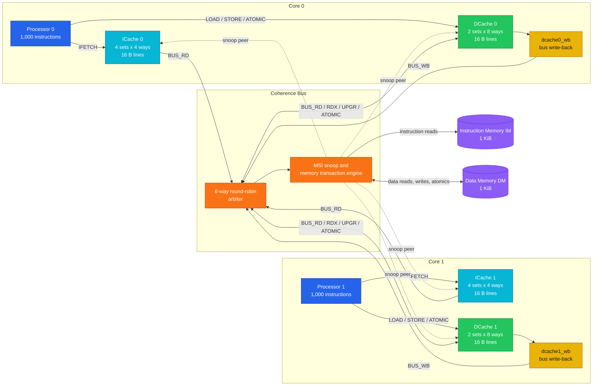
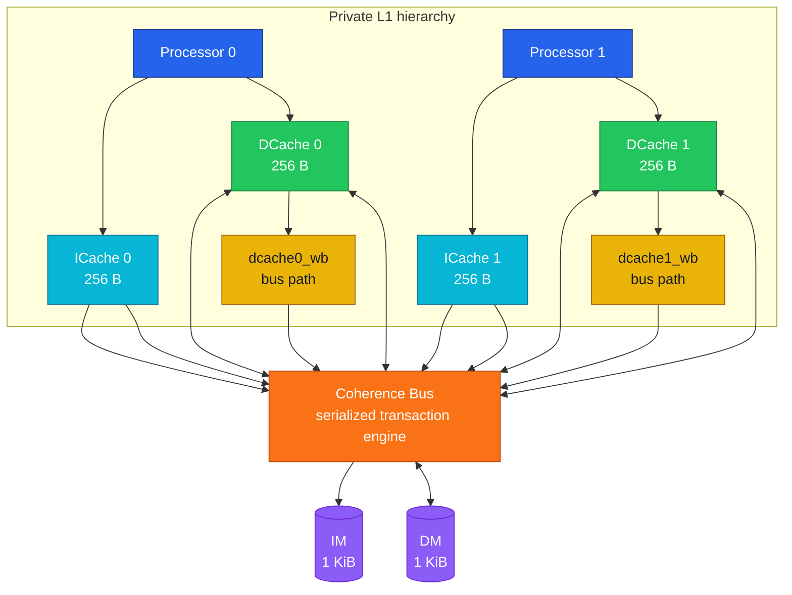
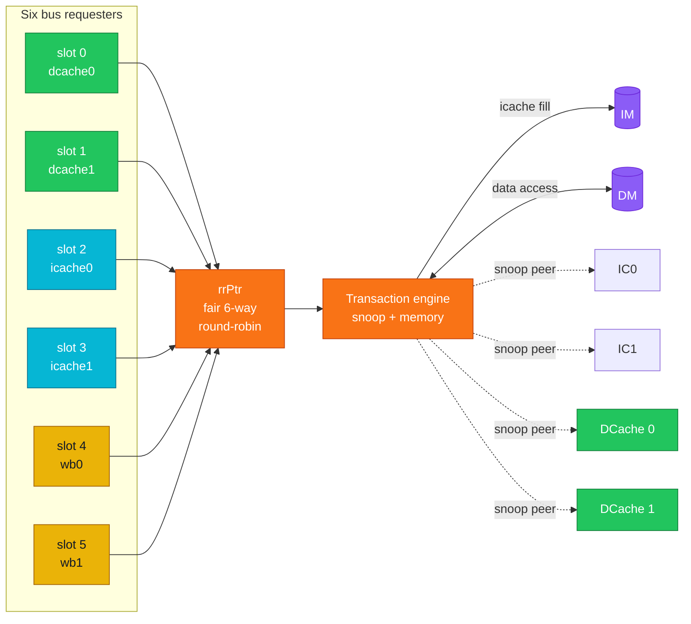
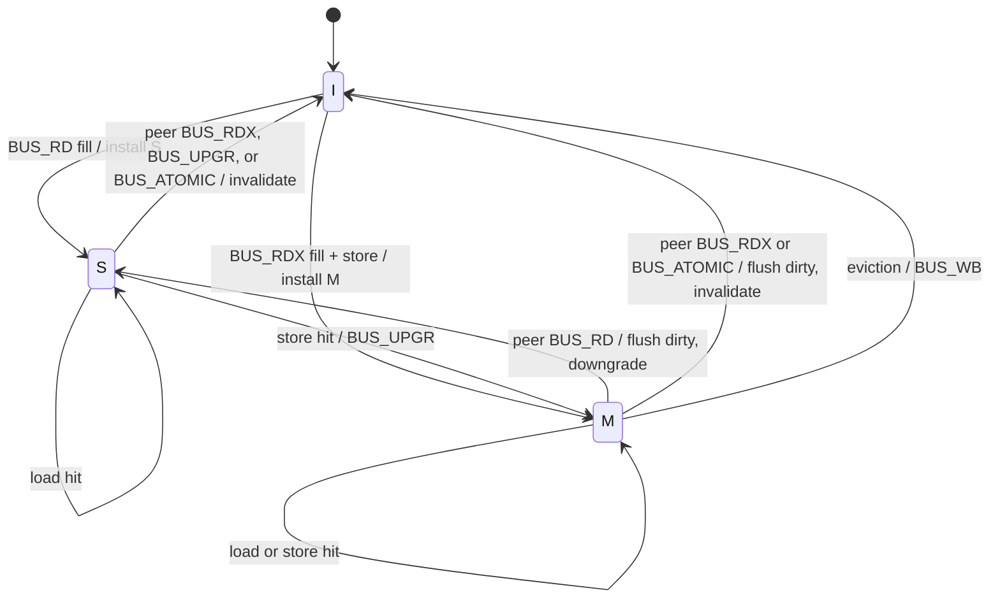
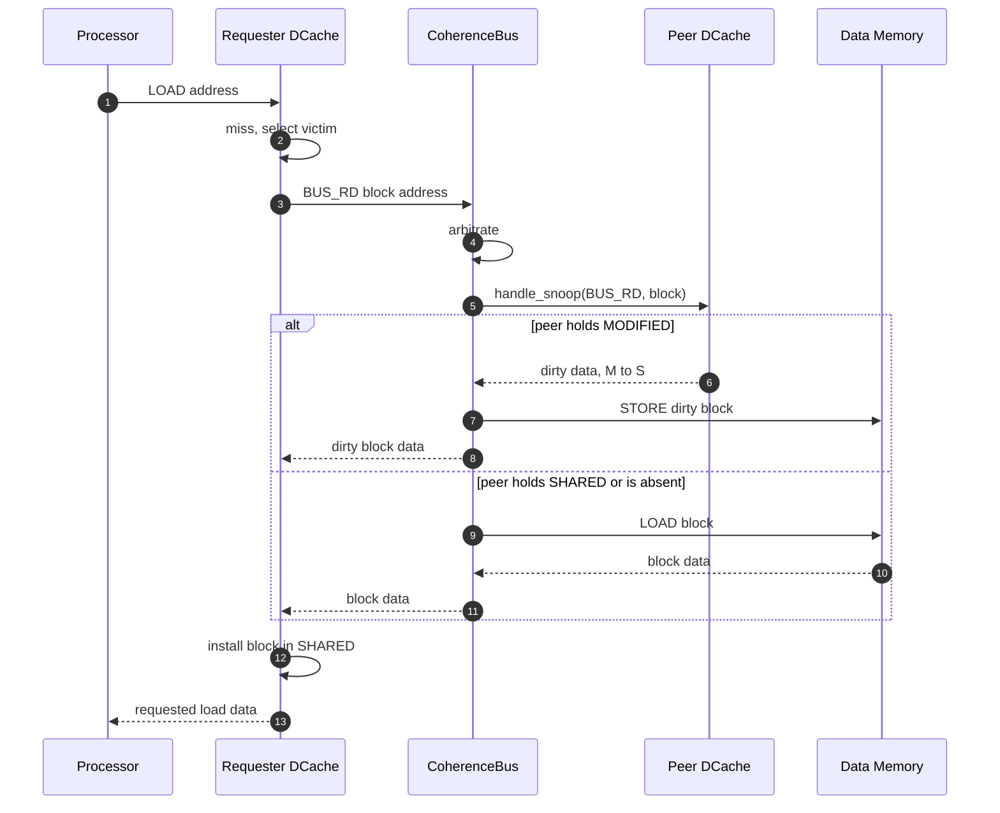
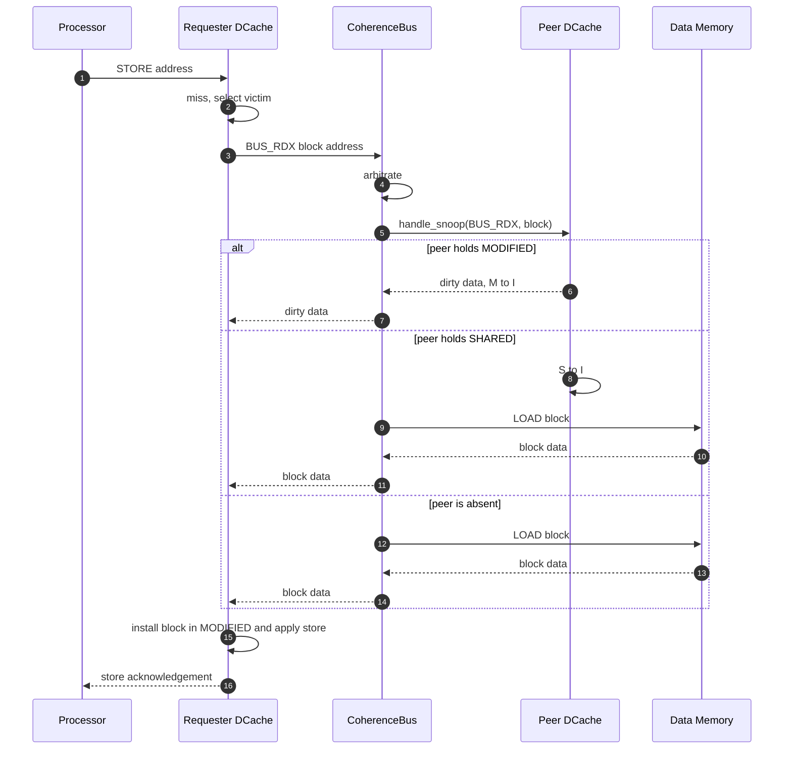
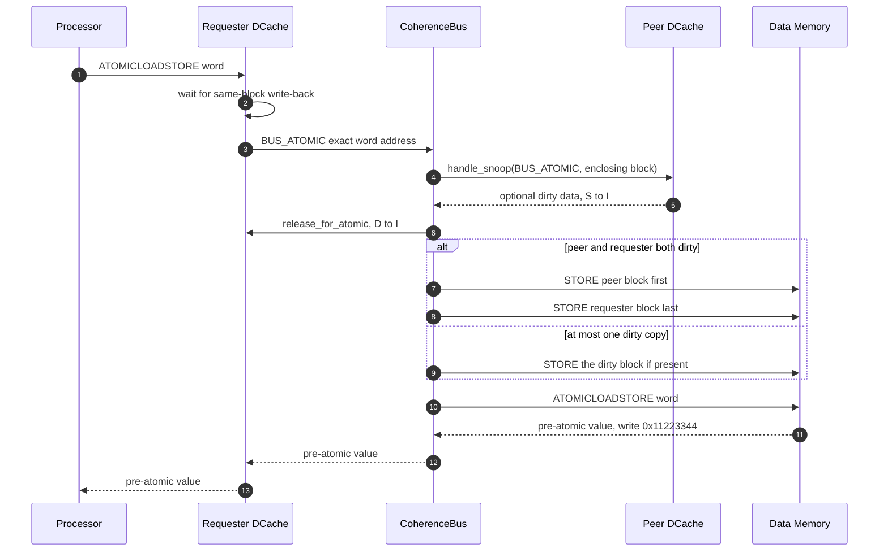
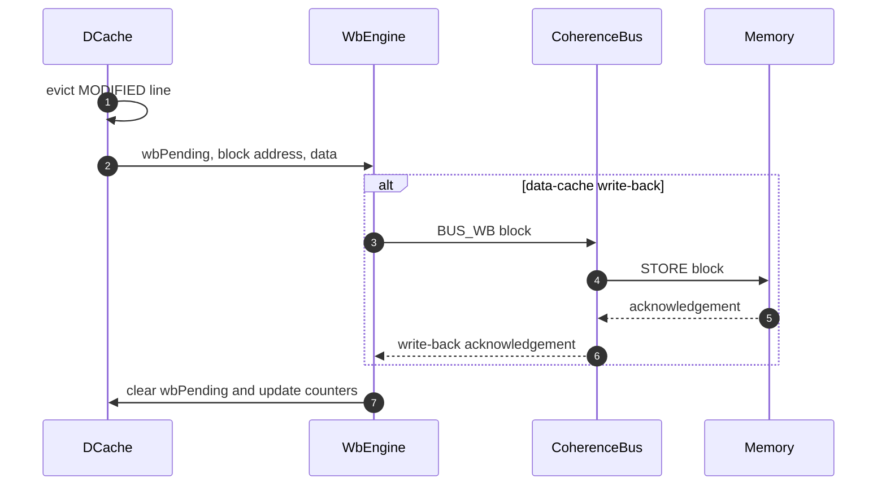

# Bachelor of Technology Project Report

## 1. Title Page

# Cycle-Accurate Dual-Core MSI Cache-Coherence Simulator

### Design, Verification, and Performance Evaluation

**Project:** Sitar Assignment 1 — Dual-Core Shared-Memory Multiprocessor

**Report type:** BTP project report

**Source snapshot:** `/home/sidd64/Sitar_Assignment_1/model.sitar`

**Model SHA-256:** `3b9cd995535da5ae837f219e84810f013164661ac2b94a82290fc86a2a463c0e`

**Repository base commit:** `34795b3`

**Primary result snapshot:** `reports/run_20261122_152018`, also available through `reports/latest`

**Report date:** 21 November 2026

**Document status:** Final technical report

This report describes the design, implementation, protocol behavior, experimental
methodology, validation evidence, and measured results of a two-core shared-memory
simulator with private split L1 caches and MSI snooping coherence. The implementation
is written in Sitar and targets cycle-accurate simulation of processor, cache, bus,
write-back, and memory interactions.

### Table of Contents

1. [Title Page](#1-title-page)
2. [Abstract](#2-abstract)
3. [Introduction](#3-introduction)
4. [Problem Statement and Objectives](#4-problem-statement-and-objectives)
5. [System Architecture](#5-system-architecture)
6. [Component Design](#6-component-design)
7. [Communication Protocols](#7-communication-protocols)
8. [MSI Coherence Protocol](#8-msi-coherence-protocol)
9. [Replacement and Write Policies](#9-replacement-and-write-policies)
10. [Simulation Methodology](#10-simulation-methodology)
11. [Experiments](#11-experiments)
12. [Results](#12-results)
13. [Validation](#13-validation)
14. [Design Trade-offs](#14-design-trade-offs)
15. [Limitations and Future Work](#15-limitations-and-future-work)
16. [Conclusion](#16-conclusion)
17. [References](#17-references)
18. [Appendix](#18-appendix)

---

## 2. Abstract

This project implements and evaluates a cycle-accurate dual-core shared-memory
multiprocessor in Sitar. Each core has a private split L1 instruction cache and data
cache. The two data caches form an MSI coherence domain over a single shared data
memory. The two instruction caches form a separate read-only MSI sharing domain over
a shared instruction memory: each instruction-cache read snoops the peer instruction
cache, but because an instruction cache never writes, the peer copy remains `SHARED`
and no dirty intervention or invalidation occurs. Instruction and data storage remain
distinct Harvard-style address spaces.

The design includes a serialized snooping coherence bus with six-way round-robin
arbitration, write-back data caches, one-entry data-cache write-back engines, coherent
atomic read-modify-write transactions, write-buffer snoop hazards, upgrade-race
recovery, and an invariant audit. A reusable Python test harness runs 18 workload and
configuration scenarios, validates correctness, computes derived metrics, and emits
plots and machine-readable reports.

All 18 scenarios pass. Every scenario completes 1,000 instructions on both cores,
with zero simulator errors, zero dcache MSI invariant violations, zero
`BUS ATOMIC BOTH-DIRTY` events, and zero atomic old-value mismatches. In the balanced
scenario, the system completes at cycle 42,733 with aggregate IPC 0.046802, instruction
cache hit rate 88.35%, data cache hit rate 50.18%, and a bus mix of 434 `BUS_RD`,
131 `BUS_RDX`, 77 `BUS_UPGR`, 49 `BUS_WB`, and 232 `BUS_ATOMIC` transactions. Workload
sensitivity is substantial: read-only completes in 26,607 cycles, atomic-extreme in
99,342 cycles, and memory latency changes the balanced runtime from 14,356 cycles at
delay 5 to 79,235 cycles at delay 80. The results show that correctness is maintained
across contention, locality, blocking, replacement, and atomic stress, while bus and
memory serialization dominate performance.

---

## 3. Introduction

### 3.1 Background

Chip multiprocessors improve throughput by executing independent instruction streams
on private cores. Private L1 caches reduce average memory latency, but they introduce
the cache-coherence problem: a write performed by one core must not remain invisible
to another core that holds an older copy of the same block. A shared-memory system
therefore needs a protocol that orders writes, invalidates or updates stale copies,
and supplies the latest data when a cache miss occurs.

Snooping coherence is a practical solution for small-scale multiprocessors. Each
cache observes bus transactions and reacts according to the block state. The MSI
protocol uses three stable states: Invalid, Shared, and Modified. A modified block is
the unique up-to-date copy; a shared block may be replicated read-only; an invalid
block is not usable.

### 3.2 Why Simulation

Cycle-accurate simulation exposes interactions that are difficult to test in a
physical prototype or a high-level tracer: arbitration order, write-back buffering,
snoop timing, cache-delay windows, request/response handshakes, and near-simultaneous
transactions. Sitar provides procedures, modules, nets, typed tokens, and explicit
timing constructs for this purpose. The model in `model.sitar` is a complete executable
description of the system rather than a spreadsheet-style analytical model.

### 3.3 Project Context

The repository contains a dual-core extension of an earlier single-core cache
subsystem. The current source snapshot includes the instruction memory, data memory,
two processors, two instruction caches, two data caches, two data-cache write-back
engines, and one coherence bus. Both cache pairs are snooped; the instruction caches
are read-only, so their snoops confirm sharing but never invalidate. The model is
parameterized at elaboration time and can also be specialized through environment
variables at run time.

### 3.4 Contributions

The project makes the following contributions:

1. A complete dual-core shared-memory model with private split L1 caches.
2. An MSI snooping protocol covering read misses, write misses, upgrades, write-backs,
   dirty interventions, and coherent atomic read-modify-write operations.
3. A fairness-oriented six-way round-robin bus arbiter spanning both data caches,
   both instruction caches, and both data-cache write-back engines.
4. Bus-mediated write-back for the data caches, plus peer instruction-cache snooping
   for the shared instruction memory; instruction caches are read-only and require no
   write-back engine.
5. Snoop handling for dirty data still resident in the write-back buffer.
6. Recovery from an upgrade invalidation race using a `BUS_RDX` fallback.
7. Defensive flush ordering for the rare both-copies-dirty atomic case.
8. A reproducible 18-scenario validation and measurement suite with logs, metrics,
   plots, and static source checks.
9. A documented performance characterization showing the cost of coherence,
   serialization, locality, and memory latency.

---

## 4. Problem Statement and Objectives

### 4.1 Problem Statement

The system must allow two processors to execute independent instruction streams while
sharing data memory, without stale reads, lost writes, or incoherent atomics. Each
processor must have private L1 instruction and data caches. The data caches must
enforce the MSI single-writer/multiple-reader invariant. The instruction caches share
the instruction memory and must also be coherent with each other: an instruction fetch
is a read, so a fetch miss snoops the peer instruction cache. Because there is no
instruction-cache store, that snoop can only confirm a shared copy and never supplies
dirty data or invalidates. Instruction fetches remain independent of data coherence,
but must still be served through the shared memory subsystem in a fair way.

The design must also handle the practical hazards that arise in a cycle-accurate
implementation:

- a read miss that hits a modified copy in the peer cache;
- a write miss that must obtain exclusive ownership;
- a store hit on a shared line that requires an upgrade;
- a dirty victim that must be written back without blocking unrelated work;
- a snoop that arrives while the cache is waiting before responding;
- an atomic that must be serialized against all other bus traffic;
- a write-back request that is superseded by a snoop supplying the same data;
- an instruction fetch that hits a shared copy in the peer instruction cache;
- fair service for instruction caches and data-cache write-back engines.

### 4.2 Functional Objectives

| Objective | Requirement | Evidence |
| --- | --- | --- |
| Dual-core execution | Both cores complete 1,000 instructions | `RESULT instructions=1000` in every scenario |
| Private split caches | Separate icache and dcache per core | `DualCore` instantiations |
| Data MSI coherence | At most one modified dcache copy; no stale valid shared copy | Bus invariant audit; zero violations |
| Instruction coherence | Peer icache snooped on every instruction fetch | Bus peer-snoop path; static checks pass |
| Coherent atomics | Atomic RMW returns the pre-atomic value and invalidates both dcache copies | `BUS_ATOMIC` path; zero mismatches |
| Fair arbitration | No fixed priority across six bus requesters | Six-way round-robin |
| Write-back support | Dirty dcache evictions drain through two WB engines | Bus write-back path |
| Reproducibility | Deterministic address streams where required | `DET_RNG` per-core LCG |
| Automated validation | Repeatable pass/fail and metrics | `test/` suite and `reports/latest` |

### 4.3 Non-Functional Objectives

The model should be understandable, parameterized, diagnosable, and reproducible.
It should expose counters for hit rate, miss rate, bus traffic, coherence events,
write-back latency, stalls, and atomic activity. It should fail visibly rather than
silently when a protocol invariant is broken.

### 4.4 Scope and Non-Goals

The implementation is intentionally scoped to two cores, one level of private cache,
and separate instruction and data memories. It does not model a superscalar pipeline,
out-of-order execution, virtual memory, an operating system, self-modifying code, a
directory protocol, a shared L2 cache, or a network-on-chip. It is not a formal proof
of coherence; it is an executable model with extensive dynamic validation.

---

## 5. System Architecture

### 5.1 Architecture Overview

The top-level module instantiates one instruction memory (`IM`), one data memory
(`DM`), and one dual-core module (`DC`). The dual-core module contains two processors,
two instruction caches, two data caches, two data-cache write-back engines, and one
coherence bus. The instruction and data memories are distinct address spaces. Both
cache pairs are snooped: data-cache traffic snoops the peer data cache, and
instruction-cache reads snoop the peer instruction cache. The bus is the single
serialization point for all memory traffic.

**Diagram A — High-level dual-core architecture.**



### 5.2 Memory Model

The memory model is Harvard-style:

- `IM` is the instruction memory. It is shared by both instruction caches.
- `DM` is the data memory. It is shared by both data caches.
- Both memories are 1,024 bytes.
- Both are initialized with `mem[i] = i & 0xff`.
- Both are separate `Memory<>` instances; the same numeric address in `IM` and `DM`
  denotes different storage.

There is therefore no instruction/data coherence requirement in this design. A data
store or atomic changes `DM` and the peer data cache only; it never snoops or
invalidates an instruction cache. However, the two instruction caches do share `IM`,
so they are coherent with each other: every instruction fetch snoops the peer
instruction cache. Since an instruction cache has no store path, the peer copy can
only be `SHARED` or absent, and no invalidation or dirty intervention is generated.
Self-modifying code is outside the model's scope.

### 5.3 Cache Hierarchy

Each core has two private 256-byte L1 caches:

| Cache | Geometry | Capacity | Coherence role |
| --- | --- | ---: | --- |
| `icache0` | 4 sets x 4 ways x 16 B | 256 B | Read-only fill from `IM`; snoops peer icache |
| `icache1` | 4 sets x 4 ways x 16 B | 256 B | Read-only fill from `IM`; snoops peer icache |
| `dcache0` | 2 sets x 8 ways x 16 B | 256 B | Full MSI participant over `DM`; `dcache0_wb` |
| `dcache1` | 2 sets x 8 ways x 16 B | 256 B | Full MSI participant over `DM`; `dcache1_wb` |

The data caches are deliberately configured with fewer sets and more ways than the
instruction caches. This gives the two data caches a different conflict profile while
keeping capacity equal. Only the data caches have write-back engines; instruction
caches are read-only and therefore never generate a dirty line.

### 5.4 Coherence Domain

The coherence domain is exactly `{dcache0, dcache1, DM}`. The invariant is:

- at most one data cache may hold a block in `MODIFIED`;
- if one data cache holds a block in `MODIFIED`, the other must not hold a valid copy;
- both data caches may hold the block in `SHARED`;
- `INVALID` or absent means no usable copy.

The bus checks this invariant after every non-write-back transaction. The instruction caches are no longer outside this domain: they
are snooped, but because they are read-only, the audit only checks that neither holds a
modified line.

### 5.5 Principal Parameters

| Parameter | Value | Meaning |
| --- | ---: | --- |
| `P_LOAD` | 40 | Per-instruction load probability percentage |
| `P_STORE` | 30 | Per-instruction store probability percentage |
| `EXECUTION_DELAY` | 3 | Processor execution delay in cycles |
| `TOTAL_INSTRUCTIONS` | 1,000 | Instructions per core |
| `MAX_TIME` | 100,000 | Processor time limit |
| `BLOCK_SIZE` | 16 | Cache line size in bytes |
| `CACHE_DELAY` | 4 | Cache response delay |
| `MEMORY_DELAY` | 40 | Default memory access delay |
| `NUM_SETS` (icache) | 4 | Instruction-cache set count |
| `NUM_WAYS` (icache) | 4 | Instruction-cache way count |
| `NUM_SETS` (dcache) | 2 | Data-cache set count |
| `NUM_WAYS` (dcache) | 8 | Data-cache way count |
| `BUS_SNOOP_DELAY` | 2 | Snoop-only transaction delay |
| `NON_BLOCKING` | 1 | Default write-buffer behavior |
| `REPL_POLICY` | 1 | Default LRU replacement |
| `WRITE_POLICY` | 0 | Default write-back with write allocate |
| `DET_RNG` | 1 in test suite | Per-core deterministic address streams |

The top-level nets are one-entry, 22-byte request nets and 17-byte response nets.

---

## 6. Component Design

### 6.1 Top-Level Integration

`Top` is a small structural module. It instantiates `IM`, `DM`, and `DC`, and connects
the dual-core request/response ports to the memories through capacity-1 nets. The
request direction is `DC` to memory, and the response direction is memory to `DC`.
The 22-byte request and 17-byte response widths are consistent with the token payload
layouts described in Section 7.

The top level does not contain protocol logic. Arbitration, snooping, and memory
serialization are all inside `DualCore`/`CoherenceBus`, which keeps the structural
topology simple and makes the coherence domain explicit.

### 6.2 Processor

The `Processor` procedure is a synthetic single-issue workload
generator. Each iteration performs an instruction fetch and then, depending on the
configured probabilities, a data operation.

- The instruction fetch is always a word-aligned `IFETCH` of size `WORD`.
- After `EXECUTION_DELAY` cycles, the processor draws `do_load` and `do_store`.
- If load is true and store is false, it issues a `LOAD`.
- If store is true and load is false, it issues a `STORE`.
- If both are true, it issues an `ATOMICLOADSTORE`.
- If both are false, the instruction performs no data transaction and counts as an
  ALU-only instruction.
- Load and store sizes are chosen uniformly from word, doubleword, and quadword.
- Atomics are always word-sized.

Address generation uses an 8-entry history and a 1,024-byte
address space:

1. With probability `SPATIAL_LOCALITY` (default 0.6), choose a word within the same
   16-byte block as the previous address.
2. Otherwise, with probability `TEMPORAL_LOCALITY` (default 0.7) and non-empty
   history, reuse one of the last eight addresses.
3. Otherwise, choose a uniformly random word in the 1,024-byte address space.

The address is then aligned to the selected access size. The history is updated after
each selection.

The optional deterministic RNG (`DET_RNG=1`) replaces the global `rand()` with a
per-core linear congruential generator seeded from `CORE_ID`. This makes each core's
address stream independent of bus-arbitration timing, which is essential for fair
A/B comparisons.

After 1,000 instructions, or when `MAX_TIME` is reached, the processor stops issuing
work. It then sends sentinel requests (`0xFFFFFFFF`) to the instruction and data
caches to collect statistics. It sets its completion flag and waits for the peer core
before stopping the simulation.

### 6.3 Cache

The `Cache` procedure is a parameterized set-associative
cache. It is instantiated four times with different geometry, core ID, and
instruction/data role.

#### Line State

Each `CacheLine` tracks:

| Field | Purpose |
| --- | --- |
| `state` | `INVALID`, `SHARED`, or `MODIFIED` |
| `tagBit` | Block tag |
| `lastAccessCycle` | LRU timestamp |
| `insertionCycle` | FIFO timestamp |
| `accessCount` | LFU counter |
| `data` | 16-byte block payload |

#### Address Decomposition

For block size `B = 16` and `S` sets:

```text
offset = address mod B
set    = floor(address / B) mod S
tag    = floor(address / (B * S))
```

This is implemented in the cache address helpers.

#### Hit and Miss Behavior

A load or instruction fetch probes the set and compares valid tags. A hit returns
the selected bytes from the block. A miss selects a victim, parks a dirty victim in
the write-back buffer, issues a bus transaction, installs the returned block, and
then performs the requested access.

The cache supports three write policies:

- `WB_WRITE_ALLOCATE = 0`: write-back with write allocate; default.
- `WT_WRITE_ALLOCATE = 1`: write-through with write allocate.
- `WT_NO_WRITE_ALLOCATE = 2`: write-through without write allocate.

On a write-back store hit, the line becomes `MODIFIED`. On a write-through store, the
new data is also placed in the write-back buffer for draining. On a store miss with
no-write-allocate, the cache sends the store directly through the buffer without
installing a line.

#### Non-Blocking Write Buffer

The cache exposes a one-entry write buffer to its `WbEngine`:

- `wbPending`
- `wbBlockAddr`
- `wbSize`
- `wbData0..3`
- `memBusy`
- `feWaiting`
- `statWbDone`
- `statWbWaitTotal`
- `statWbWaitMax`

When `NON_BLOCKING=1`, the front end can continue after parking a write-back, subject
to buffer-conflict stalls. When `NON_BLOCKING=0`, the front end waits for the buffer
to drain before continuing. A dirty victim is invalidated in the cache array before
its data leaves the buffer; this is why snoops must also inspect the write-back
buffer.

#### Snoop Handling

`handle_snoop()` is called by the bus while the cache may be
waiting between a bus response and the front-end response. It handles:

| Snoop command | Peer line state | Action |
| --- | --- | --- |
| `BUS_RD` | `MODIFIED` | Supply dirty block, downgrade `M -> S` |
| `BUS_RD` | `SHARED` | Supply no dirty data; for icache, peer remains `S` |
| `BUS_RDX` | `MODIFIED` | Supply dirty block, invalidate `M -> I` |
| `BUS_RDX` | `SHARED` | Invalidate `S -> I` (dcache only) |
| `BUS_UPGR` | `SHARED` | Invalidate `S -> I` (dcache only) |
| `BUS_ATOMIC` | `MODIFIED` | Supply dirty block, invalidate `M -> I` |
| `BUS_ATOMIC` | `SHARED` | Invalidate `S -> I` (dcache only) |

The snoop also checks a pending write-back buffer for the same block. If the buffer
holds the dirty data and the cache array no longer does, the buffer is treated as the
source of truth. If a write-back request is already outstanding, it is canceled with
`wb_bus_err = 3` and acknowledged so the buffer is not reused underneath the
handshake.

For instruction caches, the same snoop path exists, but the peer cache has no dirty
data and cannot invalidate the requester. The snoop therefore only confirms that the
peer holds the block in `SHARED`; the request still fetches from `IM`.

#### Cache Response Delay and Saved Response

After computing a response, the cache saves `responseErr` and `responseData0..3` into
`savedResponse*`, waits `CACHE_DELAY` cycles, and then sends the saved values to the
processor. This prevents a snoop that runs during the delay
window from overwriting the value that the processor is about to receive. The saved-
response path is a direct fix for a real class of response-corruption bugs.

#### Instruction-Cache Path Note

A source comment says the instruction cache uses direct memory access. The executable
behavior is different: the instruction-cache miss path issues `BUS_RD` through the
coherence bus, and the bus forwards the request to `IM`. The behavior is authoritative
for this report. The instruction cache is bus-mediated and peer-snooped; because it
has no store path, its peer snoop can only confirm a `SHARED` copy.

### 6.4 Write-Back Engine

`WbEngine` drains a data cache's one-entry write buffer. The
final design instantiates only the bus-mode engines:

| Mode | Instantiation | Path |
| --- | --- | --- |
| Bus | `WbEngine<16, 1>` for `dcache0`/`dcache1` | Assert `wb_bus_req_valid` for `BUS_WB` |

The generic `WbEngine` source also contains a direct-memory branch (`USE_BUS=0`), but
no direct-mode instance exists in the final design. Instruction caches are read-only
and never produce a dirty line, so they have no write-back engine.

In bus mode, the engine asserts a write-back request to the bus, waits for the bus
acknowledgement, records the wait duration, and clears the buffer. A bus error value
of 3 means the write-back was canceled because a snoop supplied the same dirty data;
this is a successful cancellation, not a data error.

Each data cache and its write-back engine share the buffer variables directly through
pointers. The engine never owns a second copy of the block, which keeps the design
simple but means the cache must remain aware of the buffer during snoops.

### 6.5 Coherence Bus

`CoherenceBus` is the serialization point. It owns:

- six requester channels: `dcache0`, `dcache1`, `icache0`, `icache1`, `wb0`, `wb1`;
- four typed cache pointers: two dcache snoop targets and two icache snoop targets;
- the instruction-memory and data-memory ports;
- the six-way round-robin pointer;
- the snoop result registers;
- the invariant audit counters.

The bus request/response interface is valid-based. A requester asserts `req_valid` and
holds the request until `resp_valid` is observed. The bus then returns either data or
an error code. The bus processes exactly one transaction at a time, so the snoop and
memory effects of one grant cannot interleave with another grant.

#### Arbitration

The arbiter scans from `rrPtr` over six slots:

```text
slot 0 = dcache0
slot 1 = dcache1
slot 2 = icache0
slot 3 = icache1
slot 4 = wb0
slot 5 = wb1
```

It grants the first pending requester, then advances `rrPtr` past the granted slot.
No requester has a fixed priority. This removes the
starvation hazards of a fixed dcache-first or front-end-first policy.

#### Snooping and Memory

For every non-write-back request, the bus snoops the peer cache of the same class. A
data-cache request snoops the peer data cache. For `BUS_RD`, a dirty peer supplies the
block and is downgraded to `SHARED`; the bus writes the dirty data to `DM` and returns
the same data to the requester. For `BUS_RDX`, a dirty peer supplies the block and is
invalidated; the bus forwards the dirty data directly to the requester and does not
perform an unnecessary memory read. For `BUS_UPGR`, the bus performs a snoop-only
transaction with `BUS_SNOOP_DELAY` and does not touch memory.

An instruction-cache read snoops the peer instruction cache, then fetches the block
from `IM`. Because the instruction cache has no store path, the peer is either
`SHARED` or absent; the snoop never supplies dirty data and never invalidates. This
gives the two instruction caches a coherent shared view of `IM` without creating an
instruction/data coherence dependency.

#### Invariant Audit

After each non-write-back transaction, the bus queries both dcache and both icache line
states for the requested block. If one dcache is `MODIFIED` and the other is valid, or
if either icache is `MODIFIED`, it increments `statInvariantViolations` and logs
`INVARIANT VIOLATION`. This is a runtime assertion embedded
in the simulation, not only a post-processing check.

### 6.6 Dual-Core Integration

`DualCore` is the structural and wiring module for the two
cores. The exact instantiations are:

```text
proc0      = Processor<40, 30, 3, 1000, 100000, 16, 0>
icache0    = Cache<4, 4, 16, 4, 1, 0, 0, 0>
dcache0    = Cache<2, 8, 16, 4, 1, 0, 0, 1>
dcache0_wb = WbEngine<16, 1>

proc1      = Processor<40, 30, 3, 1000, 100000, 16, 1>
icache1    = Cache<4, 4, 16, 4, 1, 0, 1, 0>
dcache1    = Cache<2, 8, 16, 4, 1, 0, 1, 1>
dcache1_wb = WbEngine<16, 1>

bus        = CoherenceBus<16, 2, 2, 8, 4, 1, 0>
```

The module wires the bus to `IM` and `DM`, to both dcache and both icache snoop
pointers, to all four cache front-end bus channels, and to both dcache write-back bus
channels. There are no icache write-back engines: instruction-cache lines are only
installed in `SHARED` state, so no icache write-back can be generated. The icache
snoop pointers are wired so each instruction fetch observes the peer instruction
cache.

The processors are connected to their private caches through the standard
request/response pointers. Completion is coordinated through `proc0Done` and
`proc1Done`: each core sets its own flag, then waits for the peer flag before stopping
the simulation. This ensures both cores are measured to completion.

**Diagram B — Processor/cache hierarchy and interfaces.**



### 6.7 Memory

`Memory` is a single-request, blocking memory with a
parameterized delay. The key details are:

- 1,024 bytes of storage;
- initialization to `mem[i] = i & 0xff`;
- `MEMORY_DELAY = 40` by default;
- `MEMORY_DELAY` can be overridden by environment variable;
- request payload is `token<22>`; response payload is `token<17>`;
- one request at a time, with the bus as the only client of `DM` and the bus as the
  instruction-side client of `IM`.

The memory checks bounds and alignment before servicing a request:

| Error code | Meaning |
| ---: | --- |
| 0 | Success |
| 1 | Out-of-bounds access |
| 2 | Alignment error |

For `IFETCH` and `LOAD`, it reads the requested bytes. For `STORE`, it writes the
supplied block. For `ATOMICLOADSTORE`, it reads the old value, logs it, and writes
`0x11223344` to the addressed word. The old value is
returned to the requester. The memory operation is serialized by the bus, so an atomic
cannot interleave with another memory transaction.

---

## 7. Communication Protocols

### 7.1 Sitar Token Model

A Sitar `token<N>` is a fixed-size payload of `N` bytes. `sitar::pack` and
`sitar::unpack` serialize and deserialize fields sequentially with `memcpy`; the sum
of the field sizes must equal `N` at compile time. The project uses 22-byte request
tokens and 17-byte response tokens.

**Request token layout (`token<22>`):**

| Offset (bytes) | Field | Size (bytes) |
| ---: | --- | ---: |
| 0 | `address` (`uint32_t`) | 4 |
| 4 | `type` (`uint8_t`) | 1 |
| 5 | `size` (`uint8_t`) | 1 |
| 6 | `data0` (`uint32_t`) | 4 |
| 10 | `data1` (`uint32_t`) | 4 |
| 14 | `data2` (`uint32_t`) | 4 |
| 18 | `data3` (`uint32_t`) | 4 |
| **22** | **Total** | **22** |

**Response token layout (`token<17>`):**

| Offset (bytes) | Field | Size (bytes) |
| ---: | --- | ---: |
| 0 | `error` (`uint8_t`) | 1 |
| 1 | `data0` (`uint32_t`) | 4 |
| 5 | `data1` (`uint32_t`) | 4 |
| 9 | `data2` (`uint32_t`) | 4 |
| 13 | `data3` (`uint32_t`) | 4 |
| **17** | **Total** | **17** |

The fields are packed in this logical order. The underlying byte representation follows
the host ABI; the test platform is x86-64, so multi-byte fields are little-endian in
the packet payload. Sitar also gives each token a `type` and `ID` in the base token
header; those are transport metadata rather than part of the 22/17-byte payload.

### 7.2 Processor-to-Cache Handshake

The processor and cache use a valid-based handshake:

1. The processor writes `req_addr`, `req_type`, and `req_size`, clears `resp_valid`,
   and sets `req_valid`.
2. The cache observes `req_valid`, copies the request fields, clears `req_valid`, and
   begins processing.
3. The cache eventually sets `resp_err`, `resp_data0..3`, and `resp_valid`.
4. The processor observes `resp_valid`, copies the response, and clears `resp_valid`.

There is no explicit ready signal. The producer holds the valid bit until the consumer
acknowledges by clearing it. This is the same convention used throughout the model.

### 7.3 Cache-to-Bus Handshake

The cache-to-bus interface carries:

- `bus_req_valid`, `bus_req_cmd`, `bus_req_addr`, `bus_req_size`;
- `bus_resp_valid`, `bus_resp_err`, `bus_resp_d0..3`;
- for the two data-cache write-back engines, the same fields under a separate
  `wb_bus_*` namespace.

A cache asserts `bus_req_valid` and holds it until it observes `bus_resp_valid`.
The bus grants one requester at a time and returns a response to that requester only.
The cache clears `bus_resp_valid` and `bus_req_valid` after consuming the response.
This prevents a stale request from being granted twice.

### 7.4 Bus-to-Memory Handshake

The bus uses `outport::push` and `inport::peek`/`pull` with the Top-level nets. The
memory waits for phase 0 to peek at the request, and phase 1 to push the response.
The bus and write-back engines follow the complementary phase discipline: push in
phase 1, peek in phase 0. A capacity-1 net means the producer must wait if the
consumer has not drained the previous token.

This phase discipline is visible in the memory behavior and in the bus memory accesses.

### 7.5 Write-Back Engine Handshake

The final design uses only the bus mode. The engine asserts `wb_bus_req_valid`, waits
for `wb_bus_resp_valid`, records the wait duration, clears the request, and handles the
response. Error 3 is a snoop cancellation and is treated as success. Other nonzero
errors are logged as bus write-back errors. The generic `WbEngine` source still
contains a direct-memory branch, but no direct-mode instance exists in the final
design.

### 7.6 Bus Command Set

| Command | Value | Used by | Meaning |
| --- | ---: | --- | --- |
| `BUS_NONE` | 0 | — | No transaction |
| `BUS_RD` | 1 | icache/dcache | Read block, share it |
| `BUS_RDX` | 2 | dcache | Read block exclusive |
| `BUS_UPGR` | 3 | dcache | Upgrade `S` to `M`, no memory access |
| `BUS_WB` | 4 | write-back engine | Write dirty block to memory |
| `BUS_ATOMIC` | 5 | dcache | Coherent atomic read-modify-write |

**Diagram C — Bus requesters, arbitration, and memory paths.**



---

## 8. MSI Coherence Protocol

### 8.1 States and Invariant

| State | Meaning | Read allowed | Write allowed |
| --- | --- | --- | --- |
| `INVALID` (I) | No valid copy | No | No |
| `SHARED` (S) | Valid read-only copy; may be replicated | Yes | No, upgrade first |
| `MODIFIED` (M) | Unique dirty copy; memory may be stale | Yes | Yes |

The single-writer/multiple-reader invariant is enforced dynamically. The bus's
post-transaction audit checks both dcache line states for the transaction block and
flags any case where one dcache is `MODIFIED` while the other is valid. It also flags
any icache line that is `MODIFIED`, because instruction caches are read-only.

**Diagram D — MSI state transitions.**



The state diagram is intentionally written from the perspective of one data cache.
The peer commands are snoop events initiated by the other core.

### 8.2 Processor-Initiated Transitions

| Operation | Initial state | Bus action | Final state | Notes |
| --- | --- | --- | --- | --- |
| Instruction fetch miss | I | `BUS_RD` to IM | S | Peer icache snoop; peer stays S |
| Load hit | S or M | None | S or M | Returns cached data |
| Load miss | I | `BUS_RD` | S | Peer M may supply dirty data |
| Store hit | M | None | M | Local write |
| Store hit | S | `BUS_UPGR` | M | Peer copies invalidated |
| Store miss | I | `BUS_RDX` | M | Peer M supplies dirty data |
| Evict clean | S | None | I | No write-back |
| Evict dirty | M | `BUS_WB` | I | Write-back engine drains |
| Atomic | I/S/M | `BUS_ATOMIC` | I | Both copies invalidated; memory RMW |

### 8.3 Bus-Snooped Transitions

| Snoop command | Peer state | Peer action | Counters |
| --- | --- | --- | --- |
| `BUS_RD` | M | Flush dirty, M to S | dirty intervention, downgrade |
| `BUS_RD` | S | None | — |
| `BUS_RD` | I/absent | None | — |
| `BUS_RDX` | M | Flush dirty, M to I | dirty intervention, invalidation |
| `BUS_RDX` | S | S to I | invalidation |
| `BUS_UPGR` | S | S to I | invalidation |
| `BUS_ATOMIC` | M | Flush dirty, M to I | dirty intervention, invalidation |
| `BUS_ATOMIC` | S | S to I | invalidation |

### 8.4 Read Miss

A data-cache read miss issues `BUS_RD` for the block. The bus snoops the peer dcache.
If the peer is `MODIFIED`, it supplies the dirty block and transitions to `SHARED`.
The bus writes that dirty block to `DM` so memory becomes coherent, then returns the
same block to the requester. If the peer is `SHARED` or absent, the bus reads `DM`.
The requester installs the block in `SHARED` and forwards the requested bytes to the
processor.

An instruction-cache read miss also issues `BUS_RD`, but the bus snoops the peer
instruction cache first. If the peer is `SHARED`, it remains `SHARED`; no dirty data
is supplied and no invalidation occurs. The bus then fetches the block from `IM` and
returns it to the requester.

**Diagram E — Coherent read miss with optional dirty intervention.**



### 8.5 Write Miss and Invalidation

A data-cache store miss issues `BUS_RDX` for exclusive ownership. The bus snoops the
peer. If the peer is `MODIFIED`, it supplies the dirty block and transitions to
`INVALID`; the bus returns the dirty data directly to the requester and does not read
memory. If the peer is `SHARED`, it transitions to `INVALID`, and the bus reads the
block from `DM`. The requester installs the block and then applies the store, leaving
the line `MODIFIED`.

**Diagram F — Write miss, peer invalidation, and exclusive fill.**



### 8.6 Store Hit on a Shared Line and Upgrade Recovery

A store hit on a `SHARED` line cannot write locally because another cache may also
hold the block. The dcache issues `BUS_UPGR` for the block. The bus snoops the peer
and invalidates any shared copy without reading or writing memory. The requester
receives a snoop-only acknowledgement, re-checks its line, and if the line is still
valid, writes the data and changes the line to `MODIFIED`.

A race is possible: while the upgrade is queued, the peer may issue its own exclusive
request and invalidate this cache's line. To recover, the cache re-checks after the
grant. If the line is gone, it converts the operation into a `BUS_RDX` miss, installs
the block as `MODIFIED`, applies the store, and accounts for the missed upgrade. This
recovery path is implemented in the store-hit flow.

### 8.7 Atomic Read-Modify-Write

Atomics are routed through `BUS_ATOMIC` for data caches. The sequence is:

1. The requester waits for any pending write-back to the same block to drain.
2. It issues `BUS_ATOMIC` with the exact word address.
3. The bus derives the enclosing block for snooping.
4. The bus snoops the peer dcache, invalidating its copy and capturing dirty data.
5. The bus calls `release_for_atomic` on the requester, capturing its dirty data and
   invalidating its copy.
6. If both copies are dirty, the bus writes the peer's older copy to `DM` first and
   the requester's newer copy last, so the requester's value wins.
7. The bus sends `ATOMICLOADSTORE` to `DM`. The memory returns the pre-atomic value
   and writes `0x11223344` to the addressed word.
8. The bus returns the pre-atomic value to the requester.

Both caches are invalid after the transaction. This prevents a stale copy from
surviving the atomic. The bus counts the both-dirty case and logs it; the test suite
treats any such event as a warning, and the current results contain zero.

**Diagram G — Coherent atomic read-modify-write.**



### 8.8 Write-Back and Snoop Cancellation

When a dirty data-cache line is evicted, the cache invalidates the line and parks the
block in the write buffer. The data-cache write-back engine sends `BUS_WB` through
the bus. The bus handles `BUS_WB` as a memory store and returns an acknowledgement.
Instruction caches never reach this path because they never hold a modified line.

A snoop can overtake a parked write-back. If the write-back buffer contains the block
that a snoop requests, the cache supplies the buffer data directly and cancels the
pending write-back. This is essential because the cache line itself is already
invalid. If the write-back request is already in flight, the cache clears
`wb_bus_req_valid`, sets `wb_bus_err = 3`, and asserts `wb_bus_resp_valid`; the write
data-cache write-back engine treats this as a successful cancellation.

**Diagram H — Dirty write-back path.**



### 8.9 Both-Dirty Defensive Ordering

The both-dirty case is rare but not impossible in principle: the requester may hold a
modified copy while the peer still has a matching write-back buffer. The bus resolves
this by ordering the peer flush first and the requester flush second. The requester's
copy is treated as newer and authoritative. The `statBothDirty` counter and
`BUS ATOMIC BOTH-DIRTY` log line make the event observable. All current scenarios
report zero both-dirty events, so the path is defensive rather than frequently
exercised.

### 8.10 Response Integrity Across `CACHE_DELAY`

The cache may be snooped while it is waiting `CACHE_DELAY` cycles before responding to
its processor. A naive implementation would let the snoop overwrite the response
registers, corrupting the processor's data. The cache avoids this by saving the
response fields before the delay and sending the saved fields afterward
. The current validation suite finds zero atomic old-value
mismatches and zero data errors.

---

## 9. Replacement and Write Policies

### 9.1 Set Mapping

The cache uses the standard modulo mapping:

```text
block_number = floor(address / 16)
set_index    = block_number mod number_of_sets
tag          = floor(block_number / number_of_sets)
offset       = address mod 16
```

Because the block size is 16 bytes, a word access at offset 12 is the last word in a
block; an access that crosses the block boundary returns a miss. The processor aligns
requests to their size, so cross-block data accesses are avoided by construction.

### 9.2 Replacement Policies

The cache supports four replacement policies:

| Policy | Value | Victim selection |
| --- | ---: | --- |
| Random | 0 | Uniform random way |
| LRU | 1 | Smallest `lastAccessCycle`; default |
| FIFO | 2 | Smallest `insertionCycle` |
| LFU | 3 | Smallest `accessCount`, then oldest access |

An invalid way is always preferred before a replacement policy is applied. This avoids
unnecessary evictions during warm-up. The default is LRU for both data and instruction
caches. `REPL_POLICY` can be overridden by environment variable.

The `random_repl` scenario uses random replacement with the same workload as the
balanced baseline. It completes at 43,425 cycles versus 42,733 for LRU, with a slightly
lower instruction-cache hit rate and more write-backs. This is consistent with random
replacement making less informed victim choices. The reported matrix compares LRU and
random replacement; FIFO and LFU are implemented but are not experimentally
characterized here.

### 9.3 Write Policies

The default data-cache policy is write-back with write allocate:

- a store miss fetches the block exclusively (`BUS_RDX`);
- the block is installed in `MODIFIED`;
- the store is applied locally;
- the line is written back only on eviction or snoop intervention.

The two write-through modes are implemented for completeness:

- `WT_WRITE_ALLOCATE`: install the block, then also send the store through the write
  buffer.
- `WT_NO_WRITE_ALLOCATE`: do not install the block; send the store through the write
  buffer.

The default `WRITE_POLICY=0` is used by every scenario in the main matrix. The
policy is passed to the cache and to the bus's dcache pointer type, so both sides agree
on the template configuration. The write-through modes are implemented for
completeness but are not exercised by the reported 18-scenario measurements; they
remain future validation work.

### 9.4 Non-Blocking and Blocking Behavior

The one-entry write buffer allows the front end to continue after a dirty eviction
while the write-back engine drains. The model counts:

- `conflict_stall_cycles`: the next request targets the same block as a parked
  write-back;
- `buffer_stall_cycles`: the buffer is full and the front end must wait;
- `bus_wait_cycles`: the front end waits for a bus response;
- `mem_wait_cycles`: reserved for direct memory waits;
- `wb_wait_total` and `wb_wait_max`: write-back engine drain latency.

When `NON_BLOCKING=0`, the front end waits for `wbPending` to clear after parking a
write-back. The measured effect in the balanced workload is small because the bus and
memory serialization dominate, but the blocking mode reduces the maximum write-back
wait in some cases.

---

## 10. Simulation Methodology

### 10.1 Sitar Execution Model

Sitar procedures execute concurrently under a discrete-event scheduler. `wait N`
advances simulated time; `wait until(condition)` suspends until a condition holds.
The model uses `wait(0, 0)`-style scheduling points and phase-based nets to coordinate
producers and consumers. All timing values are in simulated cycles.

The model is deterministic when `DET_RNG=1`: the address streams depend only on each
core's LCG state, not on the order in which bus grants occur. This is important because
otherwise a small arbitration change can alter the workload itself, confounding
performance comparisons.

### 10.2 Workload Generation

For each of 1,000 instructions per core:

1. Fetch one word from the instruction cache.
2. Wait `EXECUTION_DELAY` cycles.
3. With probability `P_LOAD`, mark a load; with probability `P_STORE`, mark a store.
4. If both are marked, perform an atomic. If exactly one is marked, perform that
   operation. If neither is marked, perform no data access.
5. Choose a word/doubleword/quadword size for loads and stores; atomics are word-sized.
6. Generate and align an address using the locality model.
7. Wait for the cache response and count the instruction as complete.

The default probabilities are `P_LOAD=40` and `P_STORE=30`. The probability of an
atomic is therefore `0.40 * 0.30 = 0.12`, or 12% of instructions under independent
draws. The probability of an ALU-only instruction is `0.60 * 0.70 = 0.42`.

The actual `balanced` run has 549 loads, 351 stores, 232 atomics, and 868 ALU-only
instructions across both cores. The counts differ slightly from the expected values
because each core consumes its own finite random sequence.

### 10.3 Deterministic Randomness

The default mode uses the process-global `rand()`. The deterministic mode uses:

```text
state = state * 1664525 + 1013904223
random24 = (state >> 8) & 0xFFFFFF
```

Each core is seeded with `0x12345678 + CORE_ID * 0x9E3779B9`. The suite runs all
scenarios except `global_rng` with `DET_RNG=1`, so per-core address traces are
reproducible across runs and independent of bus arbitration. The `global_rng` scenario
retains the legacy global RNG to show that the system also operates in that mode.

### 10.4 Metrics

| Metric | Definition |
| --- | --- |
| Completion cycle | Maximum of the two cores' reported `RESULT cycles` |
| Aggregate IPC | Total instructions (2,000) divided by completion cycle |
| Per-core IPC | 1,000 divided by that core's reported cycles |
| ICache hit rate | ICache hits divided by ICache requests |
| DCache hit rate | DCache hits divided by DCache requests |
| Atomic count | Number of `ATOMIC` operations logged |
| Coherence events | Invalidations plus dirty interventions plus downgrades |
| Coherence events per 1k | Coherence events per 1,000 instructions |
| BUS_RD/RDX/UPGR/WB/ATOMIC | Counts of granted bus commands |
| WB average/max | Mean and maximum write-back wait duration |
| Bus wait cycles | Cycles a cache spends waiting for bus responses |
| Conflict stall | Cycles blocked on a same-block write-back |
| Buffer stall | Cycles blocked because the one-entry buffer is full |

### 10.5 Automated Test Harness

The `test/` directory contains:

| File | Role |
| --- | --- |
| `scenarios.py` | Scenario matrix and environment defaults |
| `parse_log.py` | Parses simulator logs into structured fields |
| `validate.py` | Per-run correctness and static source checks |
| `metrics.py` | Derived metrics and CSV schema |
| `plot_results.py` | Eight PNG plots |
| `run_tests.py` | Build, run, report, and symlink orchestration |
| `README.md` | Usage and validation contract |

Every run writes `reports/run_YYYYmmdd_HHMMSS/` with raw logs, `results.csv`,
`results.json`, `summary.md`, `config.json`, optional `build.log`, and plots.
`reports/latest` points to the newest run.

### 10.6 Reproduction Commands

Build and run the full matrix:

```bash
python3 test/run_tests.py --build
```

Reuse the current simulator:

```bash
python3 test/run_tests.py
```

Run a subset or list scenarios:

```bash
python3 test/run_tests.py --only balanced,read_only,atomic_heavy
python3 test/run_tests.py --list
```

Manual build and run:

```bash
/home/sidd64/Projects/sitar/scripts/sitar translate model.sitar -o Output
/home/sidd64/Projects/sitar/scripts/sitar compile -d Output -o sitar_sim
./sitar_sim 100000
```

---

## 11. Experiments

### 11.1 Scenario Matrix

All scenarios use 1,000 instructions per core. Unless stated otherwise, the defaults
are `TEMPORAL_LOCALITY=0.7`, `SPATIAL_LOCALITY=0.6`, `MEMORY_DELAY=40`,
`NON_BLOCKING=1`, `REPL_POLICY=1`, `WRITE_POLICY=0`, and `DET_RNG=1`.

| Scenario | P_LOAD | P_STORE | Locality | Delay | Non-blocking | Replacement | Purpose |
| --- | ---: | ---: | --- | ---: | ---: | --- | --- |
| `balanced` | 40 | 30 | 0.7 / 0.6 | 40 | 1 | LRU | Baseline |
| `global_rng` | 40 | 30 | 0.7 / 0.6 | 40 | 1 | LRU | Legacy global RNG |
| `read_heavy` | 70 | 10 | 0.7 / 0.6 | 40 | 1 | LRU | Read-dominated |
| `read_only` | 70 | 0 | 0.7 / 0.6 | 40 | 1 | LRU | No stores |
| `store_heavy` | 10 | 80 | 0.7 / 0.6 | 40 | 1 | LRU | Store-dominated |
| `load_extreme` | 100 | 0 | 0.7 / 0.6 | 40 | 1 | LRU | All loads |
| `store_extreme` | 0 | 100 | 0.7 / 0.6 | 40 | 1 | LRU | All stores |
| `atomic_heavy` | 80 | 80 | 0.7 / 0.6 | 40 | 1 | LRU | Mostly atomics |
| `atomic_extreme` | 100 | 100 | 0.7 / 0.6 | 40 | 1 | LRU | All atomics |
| `no_data_ops` | 0 | 0 | 0.7 / 0.6 | 40 | 1 | LRU | Instruction-only |
| `balanced_blocking` | 40 | 30 | 0.7 / 0.6 | 40 | 0 | LRU | Blocking caches |
| `pingpong_t3a` | 35 | 55 | 0.85 / 0.6 | 40 | 1 | LRU | Coherence ping-pong |
| `pingpong_blocking` | 35 | 55 | 0.85 / 0.6 | 40 | 0 | LRU | Ping-pong, blocking |
| `high_locality` | 40 | 30 | 0.9 / 0.9 | 40 | 1 | LRU | High reuse |
| `low_locality` | 40 | 30 | 0.2 / 0.2 | 40 | 1 | LRU | Low reuse |
| `fast_memory` | 40 | 30 | 0.7 / 0.6 | 5 | 1 | LRU | Fast memory |
| `slow_memory` | 40 | 30 | 0.7 / 0.6 | 80 | 1 | LRU | Slow memory |
| `random_repl` | 40 | 30 | 0.7 / 0.6 | 40 | 1 | Random | Replacement comparison |

### 11.2 Experiment Groups

The matrix is designed around five questions:

1. **Workload sensitivity:** How do load/store/atomic mixes affect cycles, IPC, and
   cache behavior? Scenarios: `read_heavy`, `read_only`, `store_heavy`,
   `load_extreme`, `store_extreme`, `no_data_ops`.
2. **Coherence cost:** How much traffic and latency come from sharing and
   invalidation? Scenarios: `balanced`, `store_heavy`, `pingpong_t3a`,
   `high_locality`, `low_locality`.
3. **Atomic serialization:** What is the cost of coherent read-modify-write?
   Scenarios: `atomic_heavy`, `atomic_extreme`.
4. **Buffering and replacement:** Do blocking write-backs or random replacement
   change the result? Scenarios: `balanced_blocking`, `pingpong_blocking`,
   `random_repl`.
5. **Memory latency:** How strongly does memory delay dominate? Scenarios:
   `fast_memory`, `slow_memory`.

### 11.3 Experimental Constraints

The processor has a hard `MAX_TIME=100000`. Two exploratory settings do not complete
within that limit:

- `MEMORY_DELAY=100` does not finish 1,000 instructions per core.
- `TEMPORAL_LOCALITY=0.1` with `SPATIAL_LOCALITY=0.1` does not finish.

The reported matrix therefore uses `slow_memory` with delay 80 and `low_locality`
with locality 0.2/0.2. `atomic_extreme` finishes at 99,342 cycles, close to the limit,
and is retained as a near-limit stress case. These are documented test constraints,
not silent substitutions.

---

## 12. Results

### 12.1 Overall Results

The latest run is `reports/run_20261122_152018`. All 18 scenarios pass.

| Scenario | Cycles | IPC | IC hit | DC hit | Atomics | Coherence/1k |
| --- | ---: | ---: | ---: | ---: | ---: | ---: |
| balanced | 42,733 | 0.046802 | 0.8835 | 0.501767 | 232 | 53.0 |
| global_rng | 44,515 | 0.044929 | 0.8770 | 0.507990 | 261 | 53.5 |
| read_heavy | 35,113 | 0.056959 | 0.8770 | 0.674768 | 134 | 19.0 |
| read_only | 26,607 | 0.075168 | 0.8665 | 0.819424 | 0 | 0.0 |
| store_heavy | 44,065 | 0.045387 | 0.8610 | 0.692402 | 159 | 78.0 |
| load_extreme | 29,831 | 0.067044 | 0.8620 | 0.854500 | 0 | 0.0 |
| store_extreme | 33,019 | 0.060571 | 0.8620 | 0.845000 | 0 | 100.0 |
| atomic_heavy | 98,637 | 0.020276 | 0.8495 | 0.096674 | 1,265 | 46.5 |
| atomic_extreme | 99,342 | 0.020132 | 0.8465 | 0.000000 | 2,000 | 0.0 |
| no_data_ops | 12,208 | 0.163827 | 0.9105 | 0.000000 | 0 | 0.0 |
| balanced_blocking | 42,670 | 0.046871 | 0.8835 | 0.503534 | 232 | 51.0 |
| pingpong_t3a | 47,720 | 0.041911 | 0.9395 | 0.474101 | 368 | 70.0 |
| pingpong_blocking | 47,599 | 0.042018 | 0.9395 | 0.474101 | 368 | 70.0 |
| high_locality | 29,797 | 0.067121 | 0.9860 | 0.625664 | 224 | 0.0 |
| low_locality | 95,655 | 0.020908 | 0.4270 | 0.255916 | 225 | 133.5 |
| fast_memory | 14,356 | 0.139315 | 0.8835 | 0.503534 | 232 | 50.5 |
| slow_memory | 79,235 | 0.025241 | 0.8835 | 0.502650 | 232 | 51.5 |
| random_repl | 43,425 | 0.046056 | 0.8735 | 0.504417 | 232 | 49.5 |

`Cycles` is the completion cycle reported by the simulation and is the maximum of the
two cores' finish times. `IPC` is aggregate IPC over 2,000 instructions. Full per-core
timing and counters are in `reports/latest/results.csv`.

### 12.2 Balanced Baseline Detail

| Metric | icache0 | icache1 | dcache0 | dcache1 |
| --- | ---: | ---: | ---: | ---: |
| Requests | 1,000 | 1,000 | 573 | 559 |
| Hits | 889 | 878 | 274 | 294 |
| Misses | 111 | 122 | 299 | 265 |
| Hit rate | 0.889 | 0.878 | 0.478185 | 0.525939 |
| Write-backs | 0 | 0 | 34 | 15 |
| `BUS_RD` | 0 | 0 | 106 | 95 |
| `BUS_RDX` | 0 | 0 | 73 | 58 |
| `BUS_UPGR` | 0 | 0 | 39 | 38 |
| Invalidations received | 0 | 0 | 24 | 27 |
| Dirty interventions | 0 | 0 | 18 | 20 |
| Downgrades | 0 | 0 | 8 | 9 |
| Final M/S/I | — | — | 12/4/0 | 10/4/2 |

Aggregate balanced counters:

| Counter | Value |
| --- | ---: |
| Completion cycle | 42,733 |
| Core 0 cycles | 42,733 |
| Core 1 cycles | 41,542 |
| Aggregate IPC | 0.046802 |
| ICache requests/hits/misses | 2,000 / 1,767 / 233 |
| ICache hit rate | 0.8835 |
| DCache requests/hits/misses | 1,132 / 568 / 564 |
| DCache hit rate | 0.501767 |
| Bus transactions | 923 |
| `BUS_RD` / `BUS_RDX` / `BUS_UPGR` / `BUS_WB` / `BUS_ATOMIC` | 434 / 131 / 77 / 49 / 232 |
| Snoop hits | 80 |
| Invalidations | 51 |
| Dirty interventions | 38 |
| Downgrades | 17 |
| Coherence events | 106 |
| Coherence events per 1k | 53.0 |
| Write-back starts / done / cancelled | 49 / 49 / 0 |
| Write-back average / maximum wait | 90.102 / 164 |
| Conflict stalls | 0 |
| Buffer stalls | 149 |
| Bus wait cycles | 93,704 |
| Write-back wait total | 4,415 |
| Atomic share of bus transactions | 25.14% |

The dominant cost is waiting on the serialized bus: 93,704 bus-wait cycles across
the two dcaches. The caches themselves have modest hit rates because the synthetic
workload deliberately mixes random, temporally local, and spatially local addresses.

### 12.3 Workload Sensitivity

- `read_only` is the fastest data-bearing scenario at 26,607 cycles. With no stores,
  there are no write-backs, no invalidations, and no coherence events. The dcache hit
  rate is 81.94%.
- `load_extreme` completes in 29,831 cycles with an 85.45% dcache hit rate and no
  coherence traffic. Read-only or read-mostly workloads benefit from shared clean
  lines and avoid the exclusive-ownership path.
- `read_heavy` completes in 35,113 cycles, while `store_heavy` completes in 44,065
  cycles. Stores are more expensive because they require exclusive ownership,
  invalidations, dirty write-backs, and more bus transactions.
- `store_extreme` completes in 33,019 cycles with 100 coherence events per 1,000
  instructions and 178 write-backs. The high dcache hit rate (84.5%) does not eliminate
  the cost of exclusive ownership and dirty eviction.
- `no_data_ops` completes in 12,208 cycles. The only bus traffic is 179 instruction-
  cache fills; the dcache is never accessed. This is the cleanest measurement of the
  fetch path and processor overhead.

### 12.4 Locality and Memory Latency

- `high_locality` completes in 29,797 cycles with an instruction-cache hit rate of
  98.6% and a dcache hit rate of 62.6%. The high reuse nearly eliminates
  instruction-fetch misses and keeps coherence traffic at zero in this trace.
- `low_locality` completes in 95,655 cycles with an instruction-cache hit rate of
  42.7% and a dcache hit rate of 25.6%. Coherence traffic rises to 133.5 events per
  1,000 instructions, and bus wait cycles reach 155,031. This is the clearest
  demonstration that locality, not raw cache capacity, dominates this workload.
- `fast_memory` completes in 14,356 cycles at delay 5, while `slow_memory` completes
  in 79,235 cycles at delay 80. The 5.52x runtime ratio shows that memory latency is
  the largest single performance lever in the current design.
- `global_rng` completes in 44,515 cycles versus 42,733 for the deterministic balanced
  run. This is not a causal RNG-speed comparison: the two runs consume different
  random sequences and therefore execute different address streams. The comparison
  demonstrates that the model works in both modes, not that one RNG is faster.

### 12.5 Atomic and Coherence Stress

- `atomic_heavy` issues 1,265 atomics and completes in 98,637 cycles. The dcache hit
  rate falls to 9.67% because every atomic is serialized through the bus and
  invalidates both data caches. The bus performs 2,084 transactions, 1,265 of which
  are atomics.
- `atomic_extreme` issues 2,000 atomics, one per instruction, and completes in 99,342
  cycles with a 0% dcache hit rate. This is close to the 100,000-cycle processor
  limit and is intentionally retained as a near-limit stress case.
- `pingpong_t3a` and `pingpong_blocking` both issue 368 atomics and complete in about
  47.6k cycles. Their instruction-cache hit rate is 93.95% because of the high
  temporal locality, while the dcache hit rate is 47.4% because ownership moves
  between cores. Blocking mode barely changes aggregate cycles but reduces the
  maximum write-back wait from 189 to 85 cycles.
- `random_repl` completes in 43,425 cycles versus 42,733 for LRU, a 1.62% increase.
  The instruction-cache hit rate drops from 88.35% to 87.35%, and write-backs rise
  from 49 to 52. The result is consistent with random replacement making less
  informed victim choices, though the difference is small for this synthetic trace.

### 12.6 Blocking vs Non-Blocking

`balanced_blocking` completes in 42,670 cycles versus 42,733 for the non-blocking
baseline, a difference of 63 cycles (0.15%). The write-back average wait falls from
90.10 to 72.45 cycles and the maximum from 164 to 120 cycles, while buffer stalls
fall from 149 to 0. The aggregate runtime is essentially unchanged because the bus
remains the bottleneck. The blocking comparison is therefore a latency-distribution
result, not a throughput win in this workload.

### 12.7 Plots

The generated plots are available in `reports/latest/plots/`:

- [Cycle counts](reports/latest/plots/cycles.png)
- [IPC](reports/latest/plots/ipc.png)
- [Cache hit rates](reports/latest/plots/hit_rates.png)
- [Bus transaction mix](reports/latest/plots/bus_mix.png)
- [Coherence events](reports/latest/plots/coherence.png)
- [Write-back latency](reports/latest/plots/wb_latency.png)
- [Stall breakdown](reports/latest/plots/stalls.png)
- [Atomic share](reports/latest/plots/atomic_share.png)

---

## 13. Validation

### 13.1 Overall Result

The latest full suite reports:

| Check | Result |
| --- | --- |
| Scenarios | 18 |
| Passed | 18 |
| Failed | 0 |
| Warnings | 0 |
| Simulator errors | 0 |
| Both-dirty events | 0 |
| Invariant violations | 0 |
| Atomic old-value mismatches | 0 |
| Instructions per core | 1,000 in every scenario |

### 13.2 Completion and Correctness Checks

For every scenario, `validate.py` checks:

1. The simulator exits successfully.
2. Both cores report 1,000 completed instructions.
3. Every `IFETCH` response matches the expected instruction-memory initialization.
4. Every atomic response matches the pre-atomic value logged by memory.
5. Load and store completions match the issued operations.
6. Cache requests partition into hits plus misses.
7. Bus atomic grants match atomic instructions.
8. Write-back start/done/cancel counts are consistent.
9. No `ERROR`, `OUT OF BOUNDS`, `ALIGNMENT ERROR`, `INVARIANT VIOLATION`, or
   timeout lines appear.
10. `BUS ATOMIC BOTH-DIRTY` is absent or surfaced as a warning.

### 13.3 Instruction-Fetch Validation

`IM` is initialized with `mem[i] = i & 0xff`. The validator reconstructs the expected
word at each `IFETCH` address and compares it with the data returned to the processor.
All instruction fetches in all 18 scenarios match. This verifies that the bus path to
`IM`, the instruction-cache fill, and the processor response are consistent.

### 13.4 Atomic Validation

For each atomic operation, the validator matches three events:

1. the `BUS ATOMIC` grant for the word address;
2. the `MEM ATOMIC` log line containing the old value;
3. the processor's `ATOMIC OK` response.

The pre-atomic bytes must match exactly. The suite reports zero mismatches in every
scenario, including `atomic_heavy` (1,265 atomics) and `atomic_extreme` (2,000
atomics). This validates the bus serialization, both-cache invalidation, memory
read-modify-write, and saved-response path together.

### 13.5 Invariant Audit

The bus checks after every non-write-back transaction that no two data caches hold
the same block in a conflicting state. The suite additionally scans the logs for
`INVARIANT VIOLATION`. Across all 18 scenarios, the count is zero. This is direct
runtime evidence for the single-writer/multiple-reader invariant.

### 13.6 Static Decoupling Checks

The static source checks in `validate.py` confirm:

| Check | Result |
| --- | --- |
| `icache0->handle_snoop` present | PASS |
| `icache1->handle_snoop` present | PASS |
| `dcache0->handle_snoop` present | PASS |
| `dcache1->handle_snoop` present | PASS |
| `bus.icache0` snoop pointer present | PASS |
| `bus.icache1` snoop pointer present | PASS |

This verifies that both instruction and data cache pairs participate in peer snooping.
The instruction-cache snoop cannot supply dirty data or invalidate, because the
instruction cache has no store path; it only keeps the two instruction caches coherent
over `IM`.

### 13.7 Write-Back Accounting

The suite compares write-back starts, completions, and cancellations. In the balanced
run, 49 write-backs start and 49 complete with 0 cancellations. In `store_extreme`,
178 start and 178 complete. In `low_locality`, 174 start and 174 complete. A snoop-
cancelled write-back is counted separately and is not treated as a lost write.

### 13.8 Limits of Validation

The validation is dynamic and scenario-based. It is strong evidence of correctness
for the tested workloads, but it is not a formal proof. It does not exhaustively
enumerate all interleavings, all address streams, or all possible cache states. The
deterministic mode improves reproducibility but also narrows the diversity of timing
interleavings relative to the global-RNG mode. Formal verification, randomized
interleaving exploration, and longer stress runs remain future work.

---

## 14. Design Trade-offs

### 14.1 Serialized Bus vs Parallel Interconnect

The bus serializes every memory transaction. This makes snooping simple and eliminates
races between concurrent memory updates, but it is the dominant performance cost:
balanced has 93,704 bus-wait cycles. A split-transaction or point-to-point interconnect
could improve throughput but would require more complex ordering and snoop handling.

### 14.2 Snooping MSI vs Directory Coherence

Snooping is appropriate for two cores and a single bus. It avoids a directory structure
and keeps all state observable. It would not scale to many cores because every
transaction is broadcast and the bus becomes a bottleneck. A directory protocol is the
natural next step for larger systems.

### 14.3 Write-Back vs Write-Through

Write-back reduces memory traffic for repeated writes and dirty-line reuse. It requires
write-back buffers, dirty snoop interventions, and careful eviction handling.
Write-through is simpler to reason about but increases memory traffic. The default
write-back policy is appropriate for this project because the bus, not memory
bandwidth alone, is already the bottleneck.

### 14.4 Write Allocate vs No-Write-Allocate

Write allocate installs the block on a store miss, which helps subsequent accesses to
the same block but requires an exclusive fill. No-write-allocate avoids the fill and
sends the store directly to memory, which is better for streaming stores but worse for
reuse. The default is write allocate.

### 14.5 Non-Blocking vs Blocking Write Buffer

The one-entry buffer overlaps a dirty write-back with subsequent work. It improves
latency hiding but introduces buffer-full and same-block conflicts. The measured
balanced result is nearly identical in aggregate cycles, but the non-blocking mode has
higher average and maximum write-back wait: 90.10 and 164 cycles versus 72.45 and 120
cycles for blocking, while buffer stalls are 149 versus 0. The non-blocking buffer
allows more overlap but also more queueing delay; aggregate throughput is unchanged
because the bus remains saturated.

### 14.6 Six-Way Round-Robin vs Fixed Priority

Round-robin removes starvation of instruction caches and data-cache write-back engines. It can
increase the latency of a single dcache request relative to a fixed dcache-first
policy, but it guarantees service. Given that both instruction fetch and write-back
progress are required for forward progress, fairness is the safer choice.

### 14.7 Atomics Through the Bus vs Direct Memory

Direct memory atomics would be faster but cannot invalidate peer copies or flush dirty
data correctly. Bus-routed atomics are slower but coherent. The `atomic_extreme`
result (99,342 cycles) shows the cost clearly. The design prioritizes correctness over
atomic throughput.

### 14.8 Harvard Instruction/Data Separation

Separate `IM` and `DM` remove instruction/data coherence hazards. The instruction
cache is read-only and peer-snooped over `IM`, so instruction-cache coherence is
simple and requires no write-back engine. The trade-off is that self-modifying code and
unified-address-space programs are out of scope.

### 14.9 Deterministic RNG

`DET_RNG=1` makes A/B comparisons meaningful by fixing each core's address stream.
The trade-off is reduced timing diversity. The suite retains `global_rng` as a
separate scenario to exercise the legacy mode.

---

## 15. Limitations and Future Work

### 15.1 Current Limitations

1. The model supports exactly two cores.
2. There is one level of private cache; there is no shared L2 or L3.
3. The coherence protocol is MSI, not MESI or MOESI. Clean shared lines are not
   distinguished from clean exclusive lines, so a store to a shared line always
   requires an upgrade transaction.
4. The bus is fully serialized and is the performance bottleneck.
5. The write buffer has one entry per cache, which limits memory-level parallelism.
6. The instruction and data address spaces are separate; self-modifying code is not
   modeled.
7. The processors are synthetic single-issue generators, not full CPU pipelines.
8. The workload is probabilistic and synthetic; no external benchmark traces are
   included.
9. Validation is dynamic and scenario-based, not a formal proof.
10. The model does not include virtual memory, interrupts, operating-system context
    switches, power/energy modeling, or a network-on-chip.
11. `MEMORY_DELAY=100` and locality 0.1/0.1 do not complete within the current
    100,000-cycle processor limit; the test matrix uses the nearest completing
    settings.

The earlier report described a deferred-install race as an accepted limitation. That
limitation is not carried forward here: the current source installs a fill immediately
after consuming the bus response, and the bus serializes transactions. No such
violation appears in the current validation. A formal proof of absence remains future
work.

### 15.2 Future Work

1. Extend the protocol to MESI or MOESI to avoid unnecessary upgrades for clean
   shared lines.
2. Add a shared L2 cache and a directory or hybrid snoop-directory protocol.
3. Scale beyond two cores and replace the single bus with a scalable interconnect.
4. Add a formal model of the MSI transitions and check the single-writer invariant
   with a model checker.
5. Add randomized stress testing with varying seeds, delays, and interleavings.
6. Add multi-entry write buffers and non-blocking miss queues.
7. Add configurable block sizes and cache geometries as first-class parameters.
8. Add trace-driven workloads from real applications.
9. Add performance counters for per-command latency distributions and queue
   occupancy.
10. Add a unified address space option for instruction/data coherence research.
11. Add energy and area estimates for design-space exploration.
12. Add a pipeline model so IPC reflects realistic instruction-level behavior.

---

## 16. Conclusion

This project delivers a complete cycle-accurate dual-core shared-memory simulator
with private split L1 caches, a shared instruction memory, a shared data memory, and
MSI snooping coherence over the data caches. The implementation covers read misses,
write misses, upgrades, write-backs, dirty interventions, write-buffer snoop hazards,
atomic serialization, upgrade-race recovery, and a runtime invariant audit. A
six-way round-robin bus arbiter provides fair service to both data caches, both
instruction caches, and both data-cache write-back engines.

The 18-scenario validation suite passes completely: both cores complete 1,000
instructions in every scenario, with zero errors, zero invariant violations, zero
both-dirty events, and zero atomic old-value mismatches. The balanced baseline
completes at 42,733 cycles with 0.046802 aggregate IPC, 88.35% instruction-cache hit
rate, 50.18% data-cache hit rate, and 923 bus transactions. The experiments show that
memory latency and bus serialization dominate: runtime ranges from 14,356 cycles with
fast memory to 79,235 cycles with slow memory, and from 29,797 cycles with high
locality to 95,655 cycles with low locality. Atomic-heavy workloads approach the
100,000-cycle limit because coherent atomics are serialized and invalidate both data
caches. Instruction-cache coherence adds peer-snoop traffic but no dirty
interventions, because instruction caches remain read-only.

The design is deliberately conservative: it favors correctness, observability, and
reproducibility over aggressive parallelism. That makes it a sound base for future
work on MESI/MOESI, shared L2 caches, directory protocols, larger core counts, formal
verification, and trace-driven evaluation.

---

## 17. References

1. D. Patterson and J. Hennessy, *Computer Organization and Design: The
   Hardware/Software Interface*, 5th ed., Morgan Kaufmann, 2014.
2. D. Culler, J. P. Singh, and A. Gupta, *Parallel Computer Architecture: A
   Hardware/Software Approach*, Morgan Kaufmann, 1999.
3. D. J. Sorin, M. D. Hill, and D. A. Wood, *A Primer on Memory Consistency and Cache
   Coherence*, 2nd ed., Springer, 2020.
4. Sitar project documentation, `/home/sidd64/Projects/sitar/docs/docs_source`,
   especially `2_basic_concepts/io_and_tokens.md` and `development.md`.
5. Sitar core token implementation, `/home/sidd64/Projects/sitar/core/sitar_token.h`
   and `/home/sidd64/Projects/sitar/core/sitar_token_utils.h`.
6. Project source, `/home/sidd64/Sitar_Assignment_1/model.sitar`.
7. Project validation suite, `/home/sidd64/Sitar_Assignment_1/test/`.
8. Project results, `/home/sidd64/Sitar_Assignment_1/reports/latest/`.
9. Sitar tool, `/home/sidd64/Projects/sitar/scripts/sitar`.

---

## 18. Appendix

### 18.1 Component Map

| Component | Key content |
| --- | --- |
| `Top` | Memory and dual-core wiring |
| `Processor` | Workload generation, address locality, completion |
| `Cache` | Set-associative cache, MSI, peer snoops, write buffer |
| `WbEngine` | Bus write-back path |
| `CoherenceBus` | Arbitration, snooping, memory serialization, invariant audit |
| `DualCore` | Instantiation and wiring |
| `Memory` | 1 KiB memory, delay, atomics, errors |

### 18.2 Token Summary

| Token | Width | Fields |
| --- | ---: | --- |
| Request | 22 bytes | address, type, size, data0, data1, data2, data3 |
| Response | 17 bytes | error, data0, data1, data2, data3 |

### 18.3 Artifact Inventory

| Artifact | Purpose |
| --- | --- |
| `model.sitar` | Authoritative Sitar model |
| `Output/` | Generated C++ translation units |
| `sitar_sim` | Compiled simulator |
| `test/scenarios.py` | 18-scenario matrix |
| `test/parse_log.py` | Log parser |
| `test/validate.py` | Correctness and static checks |
| `test/metrics.py` | Derived metrics |
| `test/plot_results.py` | Plot generation |
| `test/run_tests.py` | Test runner |
| `reports/latest/raw/` | Per-scenario raw logs |
| `reports/latest/results.csv` | One row per scenario |
| `reports/latest/results.json` | Full structured results |
| `reports/latest/summary.md` | Human-readable summary |
| `reports/latest/config.json` | Build and environment metadata |
| `reports/latest/plots/` | Eight result plots |

### 18.4 Scenario Environment Details

The full environment for each scenario is recorded in
`reports/latest/summary.md` and `reports/latest/config.json`. The key deviations
from the default are:

| Scenario | Deviation |
| --- | --- |
| `global_rng` | `DET_RNG=0` |
| `read_heavy` | `P_LOAD=70`, `P_STORE=10` |
| `read_only` | `P_LOAD=70`, `P_STORE=0` |
| `store_heavy` | `P_LOAD=10`, `P_STORE=80` |
| `load_extreme` | `P_LOAD=100`, `P_STORE=0` |
| `store_extreme` | `P_LOAD=0`, `P_STORE=100` |
| `atomic_heavy` | `P_LOAD=80`, `P_STORE=80` |
| `atomic_extreme` | `P_LOAD=100`, `P_STORE=100` |
| `no_data_ops` | `P_LOAD=0`, `P_STORE=0` |
| `balanced_blocking` | `NON_BLOCKING=0` |
| `pingpong_t3a` | `P_LOAD=35`, `P_STORE=55`, `TEMPORAL_LOCALITY=0.85` |
| `pingpong_blocking` | same as `pingpong_t3a` with `NON_BLOCKING=0` |
| `high_locality` | `TEMPORAL_LOCALITY=0.9`, `SPATIAL_LOCALITY=0.9` |
| `low_locality` | `TEMPORAL_LOCALITY=0.2`, `SPATIAL_LOCALITY=0.2` |
| `fast_memory` | `MEMORY_DELAY=5` |
| `slow_memory` | `MEMORY_DELAY=80` |
| `random_repl` | `REPL_POLICY=0` |

### 18.5 Glossary

| Term | Meaning |
| --- | --- |
| MSI | Invalid, Shared, Modified coherence protocol |
| Snooping | Caches observe bus transactions and react to maintain coherence |
| Write-back | Dirty data is written to memory only on eviction or intervention |
| Write allocate | A store miss allocates the block in the cache |
| Dirty intervention | A modified cache supplies data to another requester |
| Downgrade | A modified line becomes shared after supplying data |
| Invalidation | A valid copy is changed to invalid |
| `BUS_RD` | Read block and share |
| `BUS_RDX` | Read block exclusive |
| `BUS_UPGR` | Upgrade shared to modified without memory access |
| `BUS_WB` | Write back a dirty block |
| `BUS_ATOMIC` | Coherent atomic read-modify-write |
| IPC | Instructions per cycle |
| AMAT | Average memory access time |
| `DET_RNG` | Deterministic per-core random-number mode |

### 18.6 Reproduction Checklist

1. Confirm the model hash matches `3b9cd995535da5ae837f219e84810f013164661ac2b94a82290fc86a2a463c0e`.
2. Build with `python3 test/run_tests.py --build`.
3. Confirm `reports/latest/summary.md` reports 18 PASS and 0 failures.
4. Confirm `reports/latest/results.csv` contains the cycle values reported here.
5. Confirm zero `INVARIANT VIOLATION`, `BOTH-DIRTY`, and `ATOMIC ERROR` lines in
   `reports/latest/raw/`.
6. Inspect `reports/latest/plots/` for the visual summary.

### 18.7 Evidence Gaps

The project artifacts do not contain institutional author metadata, an external
benchmark suite, or a formal proof of coherence. Those items are therefore not claimed
in this report. All performance and correctness numbers are taken from the inspected
source snapshot and the latest generated report. The report intentionally distinguishes
between implemented behavior, observed measurements, and future work.
