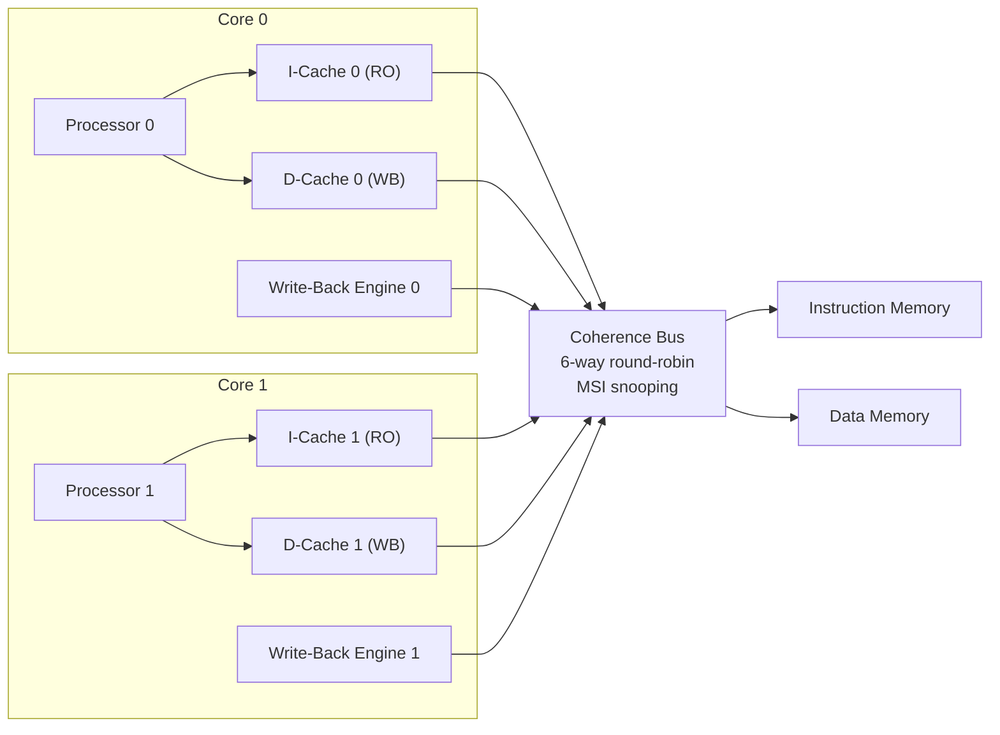

# Dual-Core Cache Coherence Simulation on Sitar

A cycle-accurate model of a **two-core shared-memory multiprocessor** written in the
Sitar discrete-event DSL. Each core has a private split L1
instruction and data cache, and both data caches are kept coherent with an **MSI
snooping protocol** over a single shared coherence bus. The model is parameterizable,
instrumented, and checked automatically by a reusable Python regression harness.

**Author:** Siddharth Suryavanshi · Roll No. 2303325 · IIT Goa (Mathematics and Computing)

---

## At a glance

- **2** in-order cores, `1000` instructions each, `3`-cycle execution delay.
- **4** caches: private split L1 (`256 B` each), set-associative, LRU.
- **MSI** coherence (`Invalid / Shared / Modified`) with `BusRd`, `BusRdX`, `BusUpgr`,
  `BusWB`, and coherent atomic `BusAtomic` transactions.
- **1** serialized coherence bus with **six-way round-robin** arbitration over both
  data caches, both instruction caches, and both write-back engines.
- **Harvard** address spaces: separate instruction memory (`IM`) and data memory (`DM`).
- **18** automated workload/configuration scenarios, `18/18 PASS`, `0` errors, `0`
  invariant violations, `7/7` static model checks.

---

## System architecture

One `CoherenceBus` is the only master of both memories. Every cache line is snooped; the
read-only instruction caches confirm sharing but never supply dirty data or write back.



| Component | Configuration |
| --- | --- |
| Cores | 2 in-order, blocking · 1000 instr · 3-cycle exec delay · each instr starts with a fetch |
| L1 I-cache | 4 sets x 4 ways x 16 B = 256 B · LRU · 4-cycle access · read-only · peer-snooped |
| L1 D-cache | 2 sets x 8 ways x 16 B = 256 B · LRU · write-back, write-allocate · 4-cycle access · MSI per line |
| Write-back buffer | One entry per D-cache, drained by a separate write engine |
| Coherence bus | Single shared bus · round-robin over 6 requesters · 2-cycle snoop delay |
| Memory | Separate IM and DM · one request at a time · 40-cycle default latency · 1 KB address space |

### MSI protocol summary

| Event | Bus command | Behaviour |
| --- | --- | --- |
| Read hit | none | Served locally in 4 cycles |
| Read miss | `BusRd` | A Modified peer intervenes and drops to Shared; otherwise memory supplies it. Installs Shared. |
| Write miss | `BusRdX` | Modified peer hands over data; Shared peers invalidated. Installs Modified. |
| Write hit in Shared | `BusUpgr` | Peer copy invalidated, no data moves. |
| Write hit in Modified | none | Silent write. |
| Atomic RMW | `BusAtomic` | Dirty copies flushed (older first, requester last), both invalidated, RMW runs at memory, old value returned. |
| Evict Modified | `BusWB` | Parked in the write buffer and drained by the write engine. |

Design corners covered by the model: upgrade-vs-invalidation race recovery (`BusUpgr`
retried as `BusRdX`), dirty data still resident in the write-back buffer, and the rare
both-copies-dirty atomic ordering. Correctness is audited inside the model: after every
non-write-back transaction the bus checks the block invariant and counts any violation.

---

## Repository layout

```
.
├── model.sitar                     # Complete Sitar model (top module, caches, bus, cores)
├── sitar_sim                        # Prebuilt simulator binary (rebuilt with --build)
├── test/                            # Python regression + metrics + plotting harness
│   ├── run_tests.py                 # CLI, build orchestration, report generation
│   ├── scenarios.py                 # 18-scenario workload matrix
│   ├── parse_log.py                 # Simulator log parser
│   ├── validate.py                  # Correctness checks + static model checks
│   ├── metrics.py                   # Derived performance metrics
│   ├── plot_results.py              # PNG plots
│   └── README.md                    # Detailed harness reference
├── reports/                         # Generated runs (git-ignored); reports/latest -> newest
├── BTP_Report.md                    # Full technical design + evaluation report
├── Dual Core Cache Simulation on SiTAR.md  # Condensed project write-up
├── BTP_ROADMAP.md                   # Milestone history
└── BTP_Presentation.pptx            # Progress-review slides
```

> `reports/` and Sitar's `Output/` scratch directory are git-ignored and regenerated by
> the harness on every run.

---

## Prerequisites

- **Python 3.10+** with `matplotlib` and `numpy` (no pandas required).
- **Sitar toolchain** (`translate` + `compile`). The harness calls `sitar`, which turns
  `model.sitar` into C++ and builds it with **SCons**, so a working **C++ compiler** and
  **SCons** must be available. The default tool path is
  `/home/sidd64/Projects/sitar/scripts/sitar`; override it with `--sitar PATH`.

```bash
pip install matplotlib numpy
```

A `sitar_sim` binary is committed, so you can run the suite without rebuilding, but pass
`--build` after any change to `model.sitar`.

---

## Quick start

From the repository root:

```bash
# Run the full 18-scenario suite against the existing sitar_sim binary
python3 test/run_tests.py

# Rebuild the simulator first (use after editing model.sitar)
python3 test/run_tests.py --build

# Run a subset of scenarios
python3 test/run_tests.py --only balanced,read_only,atomic_heavy

# List scenarios and their effective environment
python3 test/run_tests.py --list

# Skip plots
python3 test/run_tests.py --no-plots
```

Every run writes a timestamped directory under `reports/` and refreshes the
`reports/latest` symlink. See [`test/README.md`](test/README.md) for the full option
reference and exit-code meanings.

---

## Configuration

Model parameters are set through environment variables (defaults in
`test/scenarios.py`). The scenario matrix overrides them to form the 18 cases.

| Variable | Default | Meaning |
| --- | --- | --- |
| `P_LOAD` | `40` | Probability an instruction issues a load |
| `P_STORE` | `30` | Probability an instruction issues a store (load+store => atomic) |
| `TEMPORAL_LOCALITY` | `0.7` | Likelihood of reusing a recently touched address |
| `SPATIAL_LOCALITY` | `0.6` | Likelihood of a nearby address |
| `MEMORY_DELAY` | `40` | Cycles per memory access |
| `NON_BLOCKING` | `1` | Overlap execution with write-backs (`0` = blocking) |
| `REPL_POLICY` | `1` | `0` random, `1` LRU, `2` FIFO, `3` LFU |
| `WRITE_POLICY` | `0` | `0` write-back/write-allocate, `1` write-through/allocate, `2` write-through/no-allocate |
| `DET_RNG` | `1` | Deterministic per-core RNG so address streams are arbitration-independent |

---

## Scenario matrix

The suite exercises correctness and performance across workloads, locality, latency,
replacement, write policy, and blocking behaviour:

| Group | Scenarios |
| --- | --- |
| Baseline | `balanced`, `global_rng`, `balanced_blocking` |
| Workload | `read_heavy`, `read_only`, `store_heavy`, `load_extreme`, `store_extreme` |
| Atomic | `atomic_heavy`, `atomic_extreme` |
| Coherence | `pingpong_t3a`, `pingpong_blocking` |
| Locality | `high_locality`, `low_locality` |
| Memory | `fast_memory`, `slow_memory` |
| Policy | `random_repl`, `no_data_ops` |

---

## Validation & results

Each run is checked for: clean simulator exit, both cores completing 1000 instructions,
no `ERROR` / `INVARIANT VIOLATION` / `OUT OF BOUNDS` lines, atomic old-value integrity,
IFETCH byte checks against memory, write-back start/done/cancel accounting, cache request
partitioning, and static source checks (no I-cache write-back engine; snoops reach all
four caches).

Headline numbers from `reports/run_20261122_152018`:

| Scenario | Cycles | IPC | I$ hit | D$ hit |
| --- | ---: | ---: | ---: | ---: |
| `balanced` | 42,733 | 0.047 | 0.883 | 0.502 |
| `read_only` | 26,607 | 0.075 | 0.867 | 0.819 |
| `high_locality` | 29,797 | 0.067 | 0.986 | 0.626 |
| `low_locality` | 95,655 | 0.021 | 0.427 | 0.256 |
| `fast_memory` | 14,356 | 0.139 | 0.883 | 0.504 |
| `slow_memory` | 79,235 | 0.025 | 0.883 | 0.503 |
| `atomic_extreme` | 99,342 | 0.020 | 0.847 | 0.000 |

**Findings:** locality and memory latency dominate runtime; read-only traffic produces no
invalidations, while stores and atomics drive coherence events; atomics are fully
serialized through the bus, making the atomic stress case the slowest.

---

## Limitations & future work

- Combined IPC is capped (`≤ 0.164`) by in-order blocking cores, 40-cycle memory, and a
  single shared bus.
- Validation uses synthetic traffic, two cores, and invariant checks — not end-to-end
  data-value comparison against a reference.

Planned extensions: MESI/MOESI (Exclusive state), more cores with a directory protocol,
a split-transaction bus, real program traces with end-to-end checking, and write-through
under coherence.

---

## Documentation

- [`BTP_Report.md`](BTP_Report.md) — full design, protocol, methodology, and evaluation.
- [`Dual Core Cache Simulation on SiTAR.md`](Dual%20Core%20Cache%20Simulation%20on%20SiTAR.md) — condensed write-up.
- [`test/README.md`](test/README.md) — harness usage, scenarios, and outputs.
- [`BTP_ROADMAP.md`](BTP_ROADMAP.md) — milestone history.

## AI assistance

An AI coding assistant was used as a design and debugging aid (architecture comparison,
`snoop`/atomic reasoning, bug fixes, and documentation drafting). Every change was
reviewed, rebuilt, and run through the full suite. All performance and correctness
figures come from generated runs — no results were fabricated.
